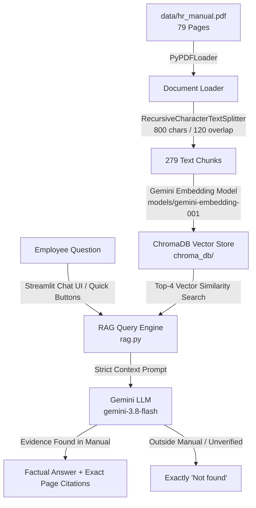

# Project 1 — HR Policy Assistant

An enterprise-grade Retrieval-Augmented Generation (RAG) assistant for employee policy queries, built on the 79-page **Enso Group HR Policy Manual**.

Developed using **Python**, **Streamlit**, **LangChain**, **ChromaDB**, and the **Google Gemini API**.

---

## 🏛️ System Architecture & Workflow



1. **Ingestion (`ingest.py`):**
   * Loads `data/hr_manual.pdf` and normalizes page metadata to original 1-based page indices (`1` to `79`).
   * Splits document into ~800-character segments with 120-character overlap (yielding 279 chunks).
   * Generates vector embeddings and persists them in `./chroma_db` under collection `enso_hr_policy`.
   * Checks for existing collections on startup to prevent duplicate embedding calls.

2. **RAG Backend (`rag.py`):**
   * Retrieves top-4 most relevant chunks via semantic similarity.
   * Feeds retrieved passages into `gemini-3.8-flash` with zero temperature (`temperature=0.0`) for deterministic responses.
   * Strict boundary guardrail: If the question cannot be answered purely from the provided excerpts, the model returns **strictly** `Not found`.
   * Untrusted Input Handling: Excerpts are wrapped in explicit context delimiters to prevent prompt injection.

3. **Streamlit Enterprise UI (`app.py`):**
   * **Dynamic Theme Engine:** Working Dark Mode / Light Mode switcher (`🌙 Dark Mode` / `☀️ Light Mode`) with persistent session state.
   * **Quick Evaluation Buttons:** Dedicated high-contrast 1-click buttons for all 5 assigned mid-term questions.
   * **Interactive Chat Experience:** Conversation history, loading spinner, copy-to-clipboard popovers, and helpful/flagged feedback buttons.
   * **Evidence Drawers:** Expandable source excerpts with exact 1-based page number pills.
   * **Boundary Enforcement:** Returns exclusively `Not found` with zero citations when queries are not backed by the manual.
   * **HR Manual Explorer Tab:** Search and browse all 79 pages of genuine manual chunks offline with keyword search and section preset filters.

---

## 📋 Assigned Mid-Term Evaluation Questions

The assistant includes dedicated 1-click test buttons in the UI for the 5 project questions:

| # | Question | Expected Boundary Behavior |
| :--- | :--- | :--- |
| **Q1** | *How many days of Privilege Leave (PL) does a permanent employee get per year?* | Answered from Section 3 (Leave Policy) with page citation. |
| **Q2** | *What is the probation period for employees up to Senior Manager?* | Answered from Section 1 (Employment & Probation) with page citation. |
| **Q3** | *What is the company's health-insurance premium amount?* | Answered from Section 5 (Employee Benefits) with page citation. |
| **Q4** | *What is the current GST rate in India?* | **Not found** *(Strictly rejected; external tax rate not in manual).* |
| **Q5** | *How many days of maternity leave are given?* | Answered from Section 3 (Maternity Leave Policy) with page citation. |

---

## 🚀 Setup & Execution Guide

### 1. Prerequisites
* Python 3.10+ (Tested on macOS Apple Silicon arm64 with Python 3.14)
* A Google Gemini API Key (Obtain free at [Google AI Studio](https://aistudio.google.com/))

### 2. Installation
```bash
# Clone and enter directory
cd /Users/sofiya/Desktop/Gen-AI

# Create and activate virtual environment
python3 -m venv .venv
source .venv/bin/activate

# Install dependencies
pip install --upgrade pip
pip install -r requirements.txt
```

### 3. Environment Configuration
Copy the template and configure your API key:
```bash
cp .env.example .env
```
Edit `.env` and set your credentials:
```bash
GEMINI_API_KEY="AIzaSy..."
GEMINI_CHAT_MODEL="gemini-3.8-flash"
GEMINI_EMBEDDING_MODEL="models/gemini-embedding-001"
CHROMA_PERSIST_DIRECTORY="./chroma_db"
```
*(Alternatively, you can paste your API key directly into the Streamlit sidebar during runtime without editing files).*

### 4. Running Ingestion
Index the manual into ChromaDB:
```bash
python3 ingest.py
```
*(Options: `--force` to re-index, `--pdf data/hr_manual.pdf` to specify path).*

### 5. Running Automated Tests
Execute the unit test suite:
```bash
pytest -v test_app.py
```

### 6. Launching the Streamlit Application
```bash
streamlit run app.py
```
Open your browser to `http://localhost:8501`.

---

## 🔒 Security & Data Integrity
* Local `.env` credentials, virtual environments, and ChromaDB cache files are strictly excluded via `.gitignore`.
* No hardcoded keys exist in source code.
* The system treats retrieved document content as untrusted data to protect against prompt injection.
